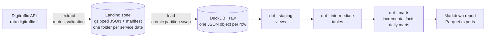

# Finnish train punctuality: an ELT pipeline

[](https://github.com/kabi-ctr/train_punctuality_elt/actions/workflows/ci.yml)
[](https://github.com/kabi-ctr/train_punctuality_elt/actions/workflows/daily.yml)

A batch ELT pipeline that pulls every train run in Finland from the
[Digitraffic](https://www.digitraffic.fi/) open rail API, lands the raw JSON, loads it
into DuckDB and models punctuality marts with dbt. It runs every morning in GitHub
Actions and publishes a report of the previous days.

**Stack:** Python (extract and load) · DuckDB (warehouse) · dbt (transformations and
tests) · GitHub Actions (CI and scheduling) · Parquet (exports)

It answers questions such as:

- What share of long-distance and commuter trains arrived on time each day?
- Which commuter lines and long-distance train types run late most often?
- Which stations have the most late departures?
- Which delay causes are reported most often?

## Latest results

From the first live run, covering 30 October to 5 November 2026. The full report is in
the [workflow run summary](https://github.com/kabi-ctr/train_punctuality_elt/actions/workflows/daily.yml).

| Date | Commuter on time | Long-distance on time |
|---|---|---|
| Fri 30 Oct | 96.8% of 1,027 | 88.5% of 227 |
| Sat 31 Oct | 93.9% of 869 | 85.9% of 184 |
| Sun 1 Nov | 98.0% of 787 | 87.3% of 189 |
| Mon 2 Nov | 97.1% of 1,031 | 86.7% of 211 |
| Tue 3 Nov | 96.3% of 1,022 | 88.3% of 214 |
| Wed 4 Nov | 96.8% of 1,028 | 84.9% of 219 |
| Thu 5 Nov | 96.7% of 1,023 | 89.4% of 208 |

Counts are measured trains: those that ran and had their final arrival recorded.

- Commuter line R was the least punctual high-volume service: 73.9% of 594 trains.
- IC trains were 84.2% punctual over 852 runs.
- The stations with the most late departures were on the northern routes: Tornio,
  Parkano, Oulainen and Kemi, where 35–39% of departures were more than 5 minutes late.
- Traffic control (821 reports) and track structure (522) were the most reported delay
  causes.

## Architecture



| Step | Command | What it does |
|---|---|---|
| Extract | `train-elt extract` | Downloads `/trains/{date}` and the station and delay-cause lists. Each response is stored unchanged, gzipped, with a manifest (URL, time, record count, SHA-256). Days already landed are skipped. |
| Load | `train-elt load` | Copies landing files into `raw.*` tables, one JSON object per row. A day is replaced as a whole inside one transaction; unchanged files (same checksum) are skipped. |
| Transform | `train-elt transform` | `dbt build`: staging, intermediate and mart models plus every data test and unit test. |
| Report | `train-elt report` / `export` | Markdown summary of the last N days; marts to Parquet. |

`train-elt run` does extract, load and transform in one go.

**Volume.** One real day (4 November 2026) is 1,807 train runs and 71,566 timetable rows,
about 21 MB of JSON. A month is roughly 2 million timetable rows.

## Design decisions

- **ELT, not ETL.** API responses are stored exactly as received, and all business logic
  lives in SQL. The rules can change and be replayed over history without calling the
  API again. The landing zone is the system of record; the warehouse can be rebuilt from
  it at any time (the daily workflow does exactly that).
- **Partitioned by Finnish service date.** The API groups trains by `departureDate` in
  Finnish time, not UTC. Train 10142 leaves Riihimäki at 01:19 local time, which is 23:19
  UTC the previous day; a test pins this down. All times are stored as UTC and converted
  to Helsinki time (DST-aware) in one macro.
- **Idempotent at every step.** Re-running any command is safe. Extract skips days it has,
  load skips files it has already loaded and checks row counts against the manifest, and
  a failed load rolls back instead of leaving half a day.
- **Late corrections.** Digitraffic updates past days. `extract --force` re-downloads a
  day, load swaps the partition, and the fact tables are incremental on the raw load
  timestamp, so only the reloaded day is rebuilt. A test covers this case.
- **Explicit punctuality rules.** A train is on time when its final arrival is at most
  *N* minutes late: 5 minutes for long-distance trains, matching
  [Traficom's statistics](https://tieto.traficom.fi/en/statistics/punctuality-long-distance-passenger-rail-services),
  and 3 minutes for commuter trains as a stricter project default. Both are dbt variables.
  Cancelled trains, and trains whose final arrival was never recorded, are counted
  separately rather than as late. Delays use only recorded times, never live estimates.
- **dbt runs as a subprocess.** dbt-duckdb holds the database file open for the life of
  its process, so running it in-process would lock the warehouse for later steps.
- **No HTTP library dependency.** The extractor uses the standard library, with
  exponential backoff, `Retry-After` support, and a `Digitraffic-User` header that
  identifies the client.

## Data model

| Model | Grain | Notes |
|---|---|---|
| `marts.fct_train_runs` | train run (date + train number) | Origin, destination, final arrival delay, `is_on_time`. Incremental. |
| `marts.fct_train_stops` | commercial arrival or departure | Delay per stop, local hour, cause count. Incremental. |
| `marts.mart_daily_punctuality` | date × category × line or train type | Scheduled, cancelled, measured, on time, %, average and p90 delay. `service_group = 'All'` holds the category total. |
| `marts.mart_station_daily` | date × station | Departures, average delay, share more than 5 min late. |
| `marts.mart_delay_causes` | date × cause category | Reports and trains affected, with Finnish and English labels. |
| `marts.dim_stations` | station | Name, type, coordinates. |

Staging models (`staging.stg_digitraffic__*`) unpack the JSON: one view each for trains,
timetable rows, delay causes, stations and cause categories.

## Testing

- **45 dbt data tests:** keys are unique and not null; relationships to stations and
  cause codes; accepted values; and four custom checks. The custom checks confirm that
  on time ≤ measured ≤ scheduled − cancelled, that each daily total equals the sum of its
  lines, that every passenger train has a final arrival, and that no delay is longer than
  a day.
- **1 dbt unit test** for the on-time rule: thresholds per category, cancelled trains,
  missing arrivals and non-passenger trains.
- **21 pytest tests**, run offline:
  - **Extract:** validation, idempotency, and an HTTP client tested against a local
    server for retries, gzip and headers.
  - **Load:** no-op reloads, partition replacement, failure modes.
  - **End to end:** seven real trains recorded from the API on 4 November 2026 go through
    extract, load and `dbt build`, and the resulting marts are checked against values
    worked out by hand.

CI runs lint and the full test suite on every push.

## Run it

Requires Python 3.11+. Run from a clone, because the CLI uses the dbt project in
`transform/`.

```bash
git clone https://github.com/kabi-ctr/train_punctuality_elt.git
cd train_punctuality_elt
python -m venv .venv && source .venv/bin/activate
pip install -e ".[dev]"

train-elt run --days 7            # extract + load + dbt build for the last 7 complete days
train-elt report --days 7         # Markdown summary
train-elt export                  # marts -> data/exports/*.parquet

pytest                            # offline, uses the recorded API responses
```

Other useful commands:

```bash
train-elt extract --date 2026-11-04               # one day
train-elt extract --start 2026-10-01 --end 2026-10-31
train-elt extract --days 3 --force                # re-download recent days
train-elt transform --full-refresh                # rebuild incremental models
train-elt prune --keep-days 30                    # trim the landing zone
```

Query the warehouse from Python:

```python
import duckdb
con = duckdb.connect("data/warehouse/trains.duckdb", read_only=True)
con.sql("""
    select departure_date, train_category, punctuality_pct
    from marts.mart_daily_punctuality
    where service_group = 'All'
    order by departure_date desc
""").show()
```

## Scheduled run

[`.github/workflows/daily.yml`](.github/workflows/daily.yml) runs every morning, about
07:20 Helsinki time. It:

1. restores the landing zone from the Actions cache, so only new days are downloaded;
2. extracts the last 7 complete days;
3. loads them and runs `dbt build`;
4. writes the report to the job summary;
5. uploads the report and Parquet marts as an artifact.

It can also be started manually with a custom number of days. GitHub pauses scheduled
workflows in repositories with no activity for 60 days.

## Performance

- **Live run in GitHub Actions** (7 real days, first run with an empty cache):
  extract 17 s, load 2 s, `dbt build` with all 60 models and tests 12 s, all passing
  with no warnings. The whole job takes about a minute.
- **Local volume check** on 30 days of cloned trains (54,600 runs, 514,800 timetable
  rows), on a 2-vCPU Linux VM: load took 2.6 s and a full `dbt build` took 8 s.

## Limitations and next steps

- Only the fact tables are incremental; staging and intermediate models are rebuilt on
  each run. That is fine at this volume but would change at years of history.
- If a corrected day drops a train entirely, its old fact row stays until
  `--full-refresh`.
- Stations come from the latest snapshot; there is no history of station changes.
- The English cause labels in `seeds/cause_category_labels.csv` are the project's own
  translations of the official Finnish names.
- Detailed cause codes (for example L201) are available in staging but not yet in the
  marts.

## Data source and licence

Source: Fintraffic / [digitraffic.fi](https://www.digitraffic.fi/), license
[CC 4.0 BY](https://creativecommons.org/licenses/by/4.0/). The data is modified by this
project: it is reshaped and aggregated into punctuality metrics. The fixtures in
`tests/fixtures/` are excerpts of API responses, re-indented with values unchanged.

Code: [MIT](LICENSE).
